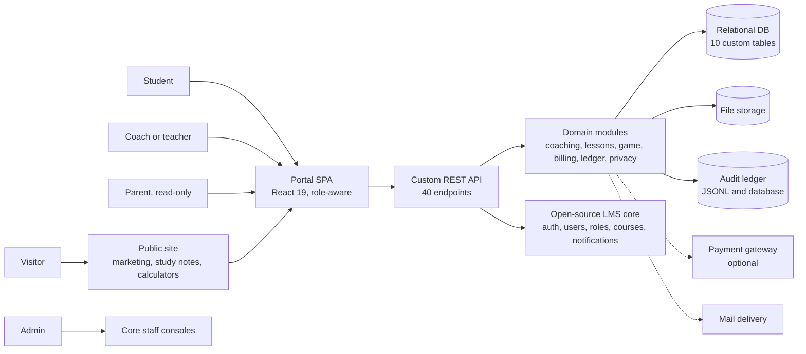
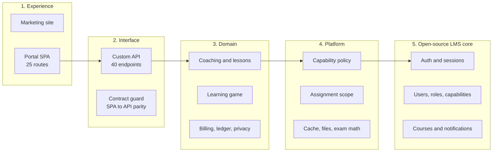
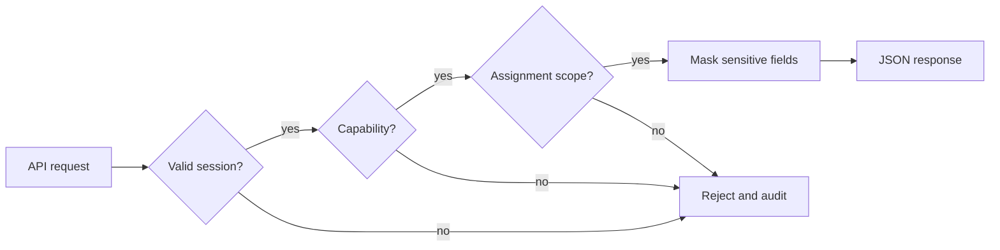

# FK Education Platform

**Status:** Proprietary, 2024–2026. Source is not public.
**Stack:** React 19, Vite, a custom REST API, a relational database, and an open-source LMS core.
**Scale:** 40 API endpoints, 10 custom tables, 25 SPA routes, 87 quality gates.

FK Education Platform is a coaching platform for an education provider. The public site has study notes, exam score calculators, and a course shelf. The portal is used by students, coaches, teachers, parents, and admins.

It runs beside an open-source LMS. It does not replace it and it does not fork it. The LMS handles identity, roles, courses, files, and notifications. The custom layer handles the coaching work.

## Why not fork

The coaching center already used the LMS. Weekly plans, student evidence, coach reviews, parent updates, and lesson payments were tracked in spreadsheets and chat.

A fork would mean merging every upstream security patch by hand. So the core stays unmodified, and everything specific to coaching lives in the custom layer.

## Architecture

### System context

Visitors reach the marketing site and the study tools. Students, coaches, and parents use the role-aware SPA. Administrators use the core's own staff consoles. The custom API is the only path into the domain modules.

### Layers

The platform has five layers. Dependencies point downward, and the experience layer never reaches around the API.

### Request flow and authorization

Every API request goes through four checks, in order. Field masking runs after them. The SPA never talks to the database directly, and the API is the only place where session, CSRF, capability, and scope decisions are made.

Five roles use the portal: student, coach, teacher, parent, and admin. A student sees only themselves. A coach sees assigned students. A teacher sees linked students. A parent sees linked children, read-only. An admin sees the whole institution.

Parents are read-only on purpose. They cannot edit plans, approve reviews, or change payments. Payment callbacks are HMAC-signed.

### Security boundaries

The browser is treated as untrusted. A request crosses an explicit session boundary, covering ingress, session authentication, and CSRF and session key validation, before it reaches the API.

Inside the API, every call is authorized twice: once by capability and once by scope. Requests from embedded activities are checked with a nonce. Sensitive fields such as prices, payment status, and peer identities are masked before the response leaves the server.

Mail is outbound only.

### Coaching tasks and game access

"Task done" and "task reviewed" are separate states. A coach publishes a week of tasks. The student marks a task done and submits evidence. The coach then approves it, requests a revision, or reopens the decision later. A revision request sends the task back to the student, who resubmits.

Game access needs all of today's tasks marked done, plus a review row in `submitted`, `approved`, or `revision_requested`. It does not wait for coach approval. That keeps the feedback loop fast, and the review trail is still there.

## How it was built

I used low-cost LLMs for the whole build: the plan, the scaffolding, the code, and the first review pass. The model was not the architect. The workflow was.

### Plan first

I wrote the product before the code. The first document covered the five roles, the weekly plan, the evidence students submit, coach review, private lessons and payments, and the parent view. From that I wrote the data model and the endpoint list.

Then I asked an LLM to turn the plan into a build sequence. The plan was short on purpose. A cheap model does better with a short plan than with a long document it can't keep in context.

### The failure that changed the order

The first weeks were fast. Then the assistant started breaking things. It added a field to the student plan and forgot the coach review and the parent dashboard. It built a modal before the migration existed. It could write code. It could not keep the whole system in view.

So I stopped feature work and wrote the scaffolding: small architecture maps, a sibling matrix, a fixed build order, a short session file, and a checker. The [SpecOS article](/#/articles/specos-architecture-for-ai-coding-assistants) explains each part.

### Building after that

Each feature followed the same loop. Update the maps, run the checker, write the migration, the API route, and the tests, then the UI, then the sibling screens, then a smoke run.

The platform ended up with 40 API endpoints, 10 custom tables, 25 SPA routes, and 87 quality gates. The gates run across static checks, behavior tests, and browser tests. An end-to-end probe checks for IDOR, race conditions, and input validation problems. A smoke test runs against the live site after each deploy.

Cheap models worked because each screen's map stayed under 3 KB and each session started from a 2,000-token handoff. The model only had to follow the file in front of it. The quality gates catch the mistakes a cheap model makes, and they catch the same mistakes an expensive one makes.

The platform runs on shared hosting, so nothing restarts a bad deploy for you. Deploys have to be checked before they go out and easy to roll back.

### After launch

Once the platform was stable, SpecOS became the maintenance layer. The maps are the documentation. The checker runs before each commit. A new session recovers the current state in under 2,000 tokens.

Adding a feature months later means opening the map for that feature, updating it, and running the same loop.

### What I took from it

- Context size matters more than model tier.
- A sibling matrix does more than a longer prompt.
- Automated checks are cheaper than rework.

The scaffolding is open source as [SpecOS](/#/articles/specos-architecture-for-ai-coding-assistants), and the repository is at [github.com/finjener/SpecOS](https://github.com/finjener/SpecOS).

## Availability

The platform is proprietary. There is no public source repository and it is not distributed as a package. This article, the screenshots, and the SpecOS project are the public part.

## Screenshots

These come from a demo tenant. Names, scores, and lesson times are made up.

| Coach: approvals and reminders | Student detail: progress overview | Student detail: goal and key numbers |
|---|---|---|
|  |  |  |

| Student detail: question trend | Student detail: weekly plan days | Student detail: wrong-answer notebook |
|---|---|---|
|  |  |  |

| Coach: student roster | Coach: student progress view |
|---|---|
|  |  |

| Coach: question trend for another student | Coach: weekly plan, later days |
|---|---|
|  |  |
