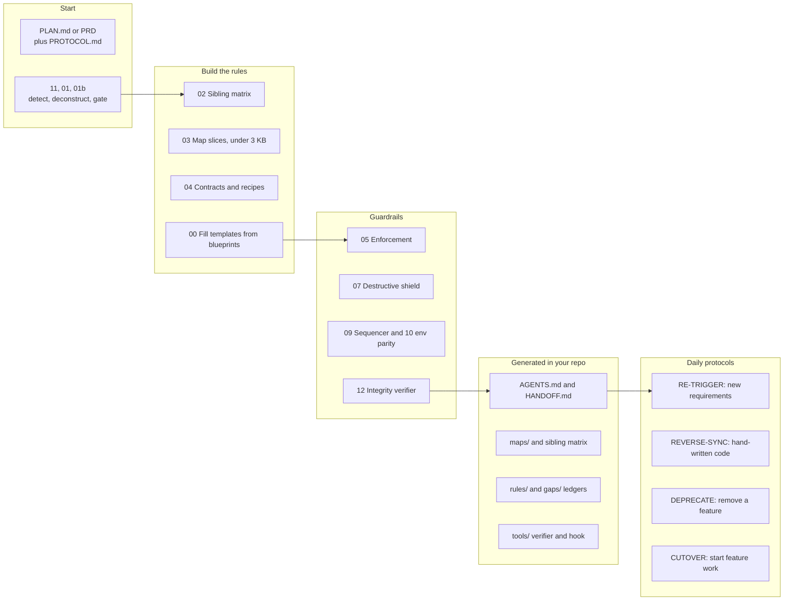

# How to have sustainable AI-assisted project development using spec-driven development with the SpecOS toolkit

Most AI-assisted projects go well for the first few days. Then they start to drift.

The assistant writes a screen and an API route in one afternoon. A week later it forgets an earlier decision, invents a column that doesn't exist, or changes the checkout flow and quietly breaks the admin view. The code still compiles. The architecture is gone.

I ran into this while building a platform with five user roles and around 40 endpoints. The usual answer is one large architecture document, and I tried that first. It grew to 50–60 KB. The assistant spent 12,000 to 15,000 tokens reading it before writing anything, and it still missed the middle. Longer prompts didn't help.

What did help was splitting the rules into small files in the repo and having the assistant check its work against them. Spec-driven development is the name for this approach: the rules live in the repository, and the assistant has to work inside them. SpecOS is a toolkit for doing that. It generates the rules, and it checks them.

## What it creates

- **Small maps.** The architecture is split into slices under `maps/`, each under 3 KB. When I work on payments, the assistant reads the payment slice, about 700 tokens, instead of the whole system. A map that grows past 3 KB usually describes two things that should be separate.
- **A sibling matrix.** `sibling-pairs-matrix.md` lists the files that must change together. Add a phone number to a user and the profile screen, the admin table, and the API contract all change.
- **A build order.** Migration, API route, tests, client bridge, main UI, sibling views, smoke run. The UI waits until the data layer is real. Assistants like to start with the UI because it looks like progress.
- **Two session files.** `AGENTS.md` holds the rules and boundaries, about 1,500 tokens. `HANDOFF.md` holds the branch, the last commit, and the next tasks, about 500 tokens. A new session starts in under 2,000 tokens.
- **Guards on destructive commands.** Raw `DROP TABLE`, `rm -rf`, hard deletes without a soft-delete flag, and secrets committed in plain text are stopped before they run. This is a guard, not a security product.

The checker is a zero-dependency Node script. `node tools/verify-specos.mjs all` checks links, map sizes, and leftover template tags.

## How it is built

The scaffolding comes from 17 pipeline steps in `core-engine/`. They run in passes, and each pass writes its files into the repository. Large projects run the same pipeline in three checkpoints, so the assistant doesn't run out of room halfway through a file.

## How I ensure sustainability

Sustainability here means the project is still easy to change in month six. With an assistant, what decides that is how much it has to read before each change.

Without structure, the assistant searches the repo, reads whatever looks related, and the amount it reads grows with the project. With SpecOS, each task follows the same path. The session starts from `AGENTS.md` and `HANDOFF.md`. The map for the area it's working on shows where the code lives. The sibling matrix lists the other files it has to check. Each map slice stays under 3 KB.

In practice the assistant almost always knows where to look. The area it needs is about the same size from one task to the next. The maps keep it pointed at the right place and the related places, and nothing more than it needs. The project can grow, but the reading cost of a single change doesn't grow with it.

That is what I mean by sustainable: a change in month six takes about as much context as a change in week one.

## Where it came from

It started as a fix for a repeated mistake, not as a tool. A field went onto the student screen and got forgotten on the coach and parent screens. A modal got built before the migration it needed. I kept patching these by hand.

At some point I wrote the rules down: which files travel together, what order to build in, and what a fresh session needs to know before it starts. Those notes became the maps and the matrix. Once the platform was stable, I pulled the reusable parts into their own repo. The case study for the platform is [here](/#/articles/fk-education-academy-architecture).

## Limits

It won't fix a bad architecture. If the system is a tangle of coupled screens, you get a precise description of the tangle.

It won't replace tests. It gives the assistant an order and boundaries. Tests still have to prove the behavior.

It's also more files to maintain. A map that nobody updates goes stale, and a stale map is worse than none. The checker catches broken links and oversized maps. It does not catch wrong content.

The maps are only as good as the plan behind them. A vague plan gives you vague maps, just neatly organized.

## When to use it

It fits projects with several user roles, a database, an API, and more than about ten views, where work spans days or weeks and context gets lost.

It does not fit a landing page, a throwaway prototype, or a short script.

## Trying it

Copy the `SpecOS/` folder into your workspace and write a short `PLAN.md`: what the app is for, who uses it, the stack, the pages, and the endpoints. Have your assistant run `PROTOCOL.md`, then run the checker. Once it passes, `CUTOVER.md` hands the project over to normal development.

After that, three protocols cover most day-to-day work: `RE-TRIGGER.md` when requirements change, `REVERSE-SYNC.md` when someone changes code by hand, and `DEPRECATE.md` when a feature goes away.

The repo is at [github.com/finjener/SpecOS](https://github.com/finjener/SpecOS) and is MIT licensed. The checker needs Node 18 or newer and has no runtime dependencies. The generated files are plain Markdown, so you can delete the generator once the scaffold is in place.
